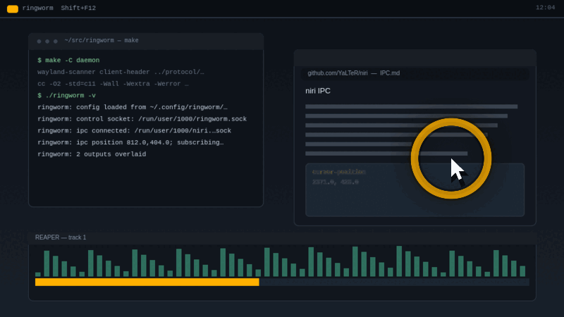

# Ringworm

**A high-visibility ring around the mouse cursor for [niri](https://github.com/YaLTeR/niri).**
Built for audio work, presentations, screen sharing, and low-vision
accessibility — anywhere losing the pointer costs you time.

Press `Shift+F12` and the cursor becomes impossible to lose. Press it again
and the ring fades away.

<p align="center">
  
</p>

[](https://github.com/Mantis-Tobbogan/ringworm/actions/workflows/ci.yml)
[](LICENSE)
[](niri-patch/)

## The problem

Wayland compositors deliberately hide the global cursor position from
clients. That is good privacy design, but it also means no overlay tool can
follow the pointer. niri — unlike Hyprland (`hyprctl cursorpos`) or KWin
(`workspace.cursorPos`) — has no escape hatch.

Ringworm is two pieces:

1. **`niri-patch/`** — a five-patch series for niri that exposes the cursor
   position over its IPC: a `CursorPosition` request, a `CursorPositionChanged`
   event on the event stream, and a `niri msg cursor-position` subcommand.
   This is the part meant for upstream; once merged, nobody needs a fork.
2. **`daemon/`** — `ringworm`, a click-through layer-shell overlay (pure C11,
   `libwayland-client` only) that draws the ring on the top layer of every
   output, fed live by the patched IPC. It never takes input, never grabs the
   keyboard, and idles at ~0% CPU.

```
┌──────────────┐   event-stream (push, JSON lines)   ┌──────────────────┐
│ patched niri │ ──────────────────────────────────▶ │ ringworm daemon  │
│  (IPC socket)│ ◀────────────────────────────────── │ (layer-shell     │
└──────────────┘   cursor-position (on connect)      │  overlay, C)     │
        ▲                                            └────────┬─────────┘
        │ spawn "ringworm" toggle                     unix socket (toggle)
        │                                            ▼
   niri config.kdl                              ringworm CLI
   binds: Shift+F12                             (one-shot client)
```

The daemon never polls the pointer: positions arrive as event-stream pushes.
Liveness is the IPC connection itself, so a resting cursor never makes the
ring fade, and the daemon never writes after subscribing
([ADR 0005](docs/adr/0005-liveness-is-the-connection.md)).

## Requirements

- Linux, [niri](https://github.com/YaLTeR/niri) **v26.04** (the pinned patch
  target; wlr-layer-shell is required)
- To build the daemon: `gcc` or `clang`, `make`, `pkg-config`,
  `wayland-scanner`, `libwayland-client`
- To build the patched compositor: the Rust toolchain plus niri's build deps
  (`scripts/build-niri.sh` lists the Fedora package set)

## Install

### 1. The daemon

```sh
make -C daemon
make -C daemon install        # → ~/.local/bin/ringworm
```

### 2. The patched compositor

```sh
./scripts/build-niri.sh       # clones v26.04, applies niri-patch/, cargo build
```

The binary lands at `niri/target/release/niri`. Point your session at it, for
example with a systemd user override:

```sh
mkdir -p ~/.config/systemd/user/niri.service.d
printf '[Service]\nExecStart=\nExecStart=%s/.local/bin/niri --session\n' "$HOME" \
  > ~/.config/systemd/user/niri.service.d/override.conf
systemctl --user daemon-reload
```

Then log out and back in.

### 3. Autostart and keybind

```kdl
# ~/.config/niri/config.kdl
spawn-at-startup "ringworm"

binds {
    Shift+F12 hotkey-overlay-title="Toggle cursor ring" { spawn "ringworm" "toggle"; }
}
```

The daemon waits in the background and the ring stays hidden until you summon
it. Prefer it always-on? Set `enabled = yes` in the config file below.

### Verify

```sh
ringworm status                 # state=off feed=live pos=… outputs=2
niri msg layers | grep ringworm # one surface per output
ringworm on                     # the ring appears
```

## Usage

```
ringworm                     run the daemon (autostart it from config.kdl)
ringworm toggle | on | off   show / hide the ring
ringworm status              daemon state, feed health, position, outputs
ringworm reload              re-read the config file, live
ringworm stop                shut the daemon down

  -v, --verbose              log to stderr
  --fake                     demo mode: sine-wave pointer, no niri IPC
  -V, --version              print version
```

Anything that can spawn a process can drive the ring: niri keybinds, REAPER
actions, a shell in an SSH session. `SIGUSR1` toggles and `SIGHUP` reloads if
you prefer signals.

## Configuration

`~/.config/ringworm/ringworm.conf` — key=value, `#` comments. Edit the file
and run `ringworm reload`; changes apply live. Missing keys keep their
defaults, and out-of-range values are clamped.

| key | default | meaning |
|---|---|---|
| `radius` | 16 | ring size, px to the ring centerline |
| `thickness` | 3 | ring stroke width, px |
| `glow` | 6 | soft halo width outside the ring (0 disables) |
| `color` | `ffb000` | hex RRGGBB |
| `alpha` | 70 | overall opacity, percent (1–100) |
| `fade_ms` | 150 | fade in/out duration, ms (0 = instant) |
| `enabled` | `no` | ring visible at startup; `yes` turns it on automatically |

A copy with comments lives at
[`daemon/ringworm.conf.example`](daemon/ringworm.conf.example).

Want it bolder for presentations? `radius = 26`, `thickness = 5`, `glow = 9`,
`alpha = 90` is the preset the demo above uses.

<p align="center">
  
</p>

The ring is drawn as anti-aliased math into ×2-supersampled shm buffers — no
cairo, no EGL — so it stays crisp at fractional scales.

## Troubleshooting

- **No ring?** `ringworm status` — `feed=disconnected` means the daemon cannot
  reach niri's IPC. Check that `NIRI_SOCKET` is set and that niri is the
  patched build (`niri msg cursor-position` should answer). `niri msg layers`
  should list `ringworm` surfaces.
- **`ringworm` exits with "another ringworm daemon is already running"** —
  expected; the control socket doubles as the single-instance lock. Use
  `ringworm toggle` instead of starting a second daemon.
- **Ring is hidden at login** — by default it starts off. Set `enabled = yes`,
  or just press your keybind.
- **Ring under a panel?** It renders on the top layer; a panel that commits
  later can sit above it. The ring is still at the pointer when the pointer is
  over the panel.
- **Patched niri fails to build after an update?** `scripts/build-niri.sh`
  pins `v26.04` and fails loudly. Until the IPC patch lands upstream, the tag
  is the supported version.

## Demo mode and media

No compositor patch is needed to see the ring:

```sh
ringworm --fake               # sine-wave pointer, ring always on
```

It runs alongside the real daemon (it owns neither the control socket nor the
feed), so you can try it without stopping anything. Quit with `Ctrl+C`.

The README media is generated from the daemon's real ring math
(`daemon/ring.c`) — no screen capture, nothing of anyone's desktop:

```sh
make -C scripts demo          # needs ImageMagick 7 → docs/media/
```

## Upstream status

The endgame is upstream: if niri accepts cursor position over IPC, the patch
series retires and Ringworm becomes a plain overlay daemon. The patches are
kept minimal and PR-shaped for exactly that reason.

## Project layout

| Path | What |
|---|---|
| `daemon/` | the overlay daemon (C11, `libwayland-client` only) |
| `niri-patch/` | patch series against niri v26.04 (GPL-3.0-or-later) |
| `protocol/` | vendored Wayland protocol XML, verbatim from upstream |
| `scripts/` | patched-niri build, virtual-pointer test tool, media generator |
| `docs/` | [plan](docs/plan.md), [ADRs](docs/adr/), [doc map](docs/README.md) |

## Contributing

Issues and PRs are welcome — see [CONTRIBUTING.md](CONTRIBUTING.md). The
short version: zero-warning C11 builds (`make -C daemon check`), conventional
commits, and every niri patch must stay PR-ready for upstream.

## License

The daemon, scripts and docs are [MIT](LICENSE). The niri patches are a
derivative of niri (GPL-3.0) and are distributed under
[GPL-3.0-or-later](niri-patch/LICENSE). Vendored protocol XML files in
`protocol/` carry their original permissive licenses inline.

## Status

Working and in daily use on niri v26.04 (Fedora, fractional scale,
multi-output). See [docs/plan.md](docs/plan.md) for the roadmap and
[docs/adr/](docs/adr/) for the decisions that shaped it.
